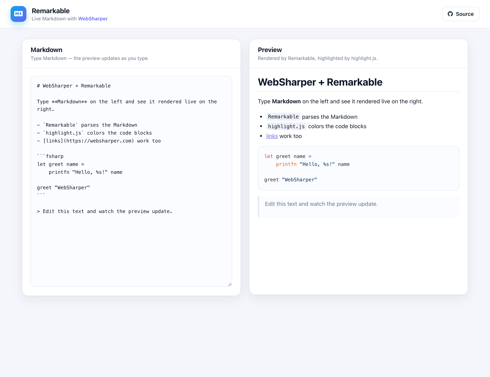

# WebSharper Remarkable

A live Markdown editor built with [WebSharper](https://websharper.com) and the
[WebSharper.Remarkable](https://github.com/dotnet-websharper/remarkable) bindings:
type Markdown on the left and see [Remarkable](https://github.com/jonschlinkert/remarkable)
render it on the right, with syntax-highlighted code blocks.

[](https://websharper-samples.github.io/Remarkable)

**[Try it live](https://websharper-samples.github.io/Remarkable)**

## What it shows

- A live Markdown preview driven by a single `Var<string>`.
- `Remarkable` HTML rendering, configured from F#.
- Fenced code blocks colored by [highlight.js](https://highlightjs.org/) — the
  old sample used `WebSharper.Google.CodePrettify`, which has no WebSharper 10
  binding, so it has been replaced with HighlightJS.

## How it works

- `src/Client.fs` keeps the Markdown in a `Var`; on every change it renders the
  HTML into the preview element and calls `Hljs.HighlightAll()`.
- `src/wwwroot/index.html` is the page — the header and the two cards — bound
  with `.Bind()`; both Remarkable and highlight.js are bundled from npm by
  [esbuild](https://esbuild.github.io/).

## Running locally

```
dotnet run --project src
```

Then open <http://localhost:5200>.

## Building

```
dotnet build src/Remarkable.fsproj -c Release
```

## Deployment

Every push to `master` builds in Release and publishes `src/wwwroot` to the
`gh-pages` branch via `.github/workflows/deploy.yml`.
